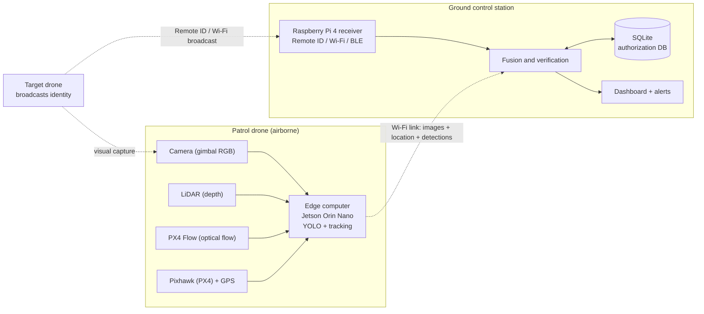
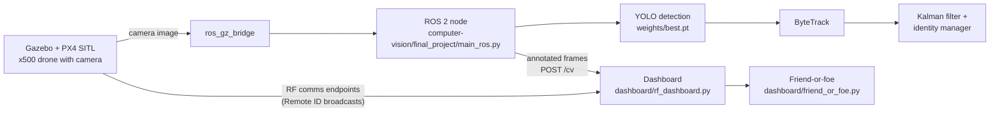
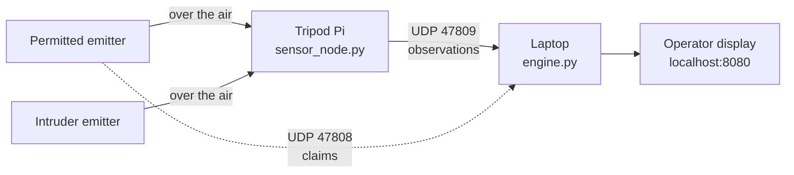

# AeroGuard

**Drone identity and authorization verification for Expo 2030 Riyadh**

AeroGuard detects drones, tracks them over time, and verifies whether each one is **authorized**, in the right **zone and time**, and following its approved **mission**. Detection and tracking run on camera video (YOLO + ByteTrack + Kalman filter); identity is checked against a registry with a friend-or-foe decision table; and a live dashboard shows the map, radio traffic, camera feed, and alerts.

> Built for the Expo 2030 Riyadh Challenge, **Track 3: Expo Operations, Safety and Security**, challenge 3.6 (alert triage and prioritization).

## Table of contents

- [The problem](#the-problem)
- [How it works](#how-it-works)
- [System architecture](#system-architecture)
- [Repository structure](#repository-structure)
- [Getting started](#getting-started)
- [Friend-or-foe logic](#friend-or-foe-logic)
- [Tracking and identity](#tracking-and-identity)
- [Hardware prototype](#hardware-prototype)
- [Demo](#demo)
- [Status and roadmap](#status-and-roadmap)
- [Alignment with the Expo challenge](#alignment-with-the-expo-challenge)
- [Acknowledgments](#acknowledgments)

## The problem

At Expo 2030 Riyadh, hundreds of authorized drones operate every day for six months, and unauthorized drones must be told apart from them in real time.

When two drones match in model, signal, and distance, physical sensors alone cannot say which one is authorized. Visual detection shows that a drone is present, but not whether it is permitted, in the correct zone and time, or on its approved mission. Identity, authorization, and operational context have to be verified together.

## How it works

```
Detect → Identify → Verify → Track → Analyze behavior → Assess threat → Alert
```

| Stage | What happens |
|---|---|
| **Detect** | YOLO detects drones in the camera feed. |
| **Identify and track** | ByteTrack and a Kalman filter follow each drone; an identity manager keeps each physical drone's ID stable, even after it is briefly lost. |
| **Verify** | The declared identity (Remote ID) and signature are checked against the registry. |
| **Analyze and alert** | Each friendly drone's position is checked against the zone its time frame allows. Mismatches are escalated. A missing identity signal alone is never treated as proof of a threat. |

**Key idea:** keep the observed **track**, the declared **claim**, and the approved **authorization** separate, then match them. This cuts unnecessary alarms and escalates only mismatches.

### Four verification layers

1. **Signature / Drone DNA:** visual, thermal, and frequency characteristics that form a distinctive profile of the drone.
2. **Remote ID / Wi-Fi / RF / BLE:** identity and live broadcast data, used to cross-check visual sightings against signals.
3. **Authorization database:** authorized drones, expected flight areas, allowed time windows, and related restrictions.
4. **System-generated tracking:** tracks built from successive detections, with motion estimates compared against the linked authorization.

Wi-Fi, Bluetooth, and flight data are supporting evidence, never independent proof of identity or authorization.

## System architecture

A patrol drone flies to the target, photographs it, and sends images, detections, and its GPS location to the ground station. Remote ID / Wi-Fi / BLE reception happens **on the ground**, on a Raspberry Pi 4 (the Raspberry Pi is used on the ground only).



Dashed lines are wireless links; solid lines are wired.

**Software data flow in the simulation**



## Repository structure

```
AeroGuard/
├── computer-vision/            Drone detection and tracking (YOLO, ByteTrack, Kalman, ROS 2)
│   ├── weights/best.pt         Trained YOLO weights
│   └── final_project/
│       ├── detection/          YOLO detector wrapper
│       ├── tracking/           ByteTrack adapter, Kalman filter, track and identity managers
│       ├── main_ros.py         ROS 2 + Gazebo live pipeline (entry point)
│       ├── main.py             Standalone pipeline
│       └── test_*.py           Detector, tracking, and identity test scripts
└── dashboard/                  Live map, radio console, and friend-or-foe verification
    ├── rf_dashboard.py         Dashboard server (web page on port 8765)
    └── friend_or_foe.py        Identity verification and zone monitoring
```

## Getting started

### Computer vision

**Requirements**

- Ubuntu with a compatible ROS 2 installation
- Gazebo and `ros_gz_bridge`
- Python packages: OpenCV, NumPy, Requests, Ultralytics
- ROS 2 Python packages: `rclpy`, `sensor_msgs`, `cv_bridge`
- An NVIDIA GPU with CUDA is recommended for inference

The default model path is `computer-vision/weights/best.pt`. From the `computer-vision` directory, with ROS 2 and Gazebo configured:

```bash
python3 -m final_project.main_ros
```

The app subscribes to the configured Gazebo camera topic and starts the ROS-Gazebo bridges itself. Defaults: image size 1280, confidence 0.25, GPU device 0. Dataset files and training outputs are not included.

### Dashboard

The dashboard uses Python standard-library modules; Gazebo (`gz`) is needed for live simulation integration.

```bash
cd dashboard
python3 rf_dashboard.py            # live, with Gazebo running; opens http://localhost:8765
python3 rf_dashboard.py --demo     # demo mode, no Gazebo needed
python3 friend_or_foe.py --selftest  # check the verification logic
```

Keep `rf_dashboard.py` and `friend_or_foe.py` in the same folder. The dashboard has a map, a friend-or-foe panel, a transmit console, a listen log (exportable as CSV), and a computer-vision panel that shows the newest camera frame sent by the vision program.

## Friend-or-foe logic

Each friendly drone broadcasts once per second a message of the form `REMOTEID_SIGMAC[_anything]`, for example `UA-001_dc:a6:32:d1:b7:01_12.0,-3.5,10.0_1759850000`:

- **Remote ID** (`UA-001` … `UA-999`): who the drone says it is.
- **Signature** (`dc:a6:32:d1:b7:01` …): its physical signature; it stands in for a heat map or frequency profile.

For every sender it hears, `friend_or_foe.py` looks both values up in the registry and applies this decision table:

| Signature ↓ / Remote ID → | Missing | In registry | Not in registry |
|---|---|---|---|
| **Not in registry** | Invader | Swapped or hacking | Invader |
| **In registry** | Invader | Friendly if they match, else hacking | Invader |
| **Missing** | Sensing issue | Sensing issue | Sensing issue |

For a **friendly** drone it also checks its position against the zone the registry gives it for the current time of day: **in zone** or **out of zone**. Zones are rectangles in the Gazebo world frame, and registry entries map each drone to a signature and time frames (`HH:MM-HH:MM`, local clock). Both are edited at the top of `dashboard/friend_or_foe.py`.

## Tracking and identity

- **Detection:** YOLO (`DroneDetector`), with a cap on box size to reject implausible detections.
- **Tracking:** ByteTrack through Ultralytics, with a 2D Kalman filter (state: position and velocity).
- **Identity manager:** creates a physical drone identity only after temporal confirmation, and re-associates lost tracks by distance and confidence:

```
Candidate → Confirmed → Lost → Re-associated → Confirmed
```

## Hardware prototype

| Location | Components |
|---|---|
| **On the drone** | Camera (gimbal RGB), LiDAR, PX4 Flow, Pixhawk (PX4) + GPS, and a **Jetson Orin Nano** edge computer running YOLO and tracking |
| **On the ground** | **Raspberry Pi 4** receiver (Remote ID / Wi-Fi / BLE), fusion and verification, the SQLite authorization database, and the dashboard with alerts |

<p>
  
  
</p>

**Signal and authorization test.** A permitted emitter and an intruder emitter broadcast over the air; a sensor node observes both, an engine matches them against claims and the registry, and an operator display shows the result:




## Demo

| Live monitoring and YOLO detections | Identity, signals, and authorization registry |
|---|---|
|  |  |
|  |  |

**Videos**

- [Simulation video](https://drive.google.com/file/d/1ahckxtsy3a_6EQRXYvmPVdAj5s15sKxE/view?usp=drive_link)
- Demo videos: [monitoring screen](https://drive.google.com/file/d/1dFdajMkzGeUqDn1QHcn0gmheioZnCfxr/view?usp=drive_link), and [monitoring screen with the drone and the monitored drone](https://drive.google.com/file/d/12xaivkUUySHxOb-HYmxtj4wi8ZhKCtHY/view?usp=drive_link)
- [Signal and drone-authorization detection mechanism](https://drive.google.com/file/d/1Bov-f6cWvYRuPc7K-1bn2o6Jq8fJF7PU/view?usp=drive_link)

## Status and roadmap

The current version is a **vertical slice**: a working prototype, a software simulation, and a live monitoring dashboard. Quantitative results (detection accuracy, tracking continuity) will be added after the real tests.

**Known challenges**

- Telling two identical drones apart, data availability, and processing time on the edge computer.
- Detecting small and distant drones, and false alarms.
- The gap between simulation and reality in vision data and frequency signatures.

**Next steps**

- Integrate the four verification layers.
- Train on broader data and drones of multiple models.
- Test in simulation, then in real flight.
- Add more radars and radio-frequency receivers.

## Alignment with the Expo challenge

**Track 3: Expo Operations, Safety and Security, challenge 3.6.** An Expo operations center struggles to tell which events need immediate action during a live event, when hundreds of alerts, wireless messages, service requests, and system notifications arrive from separate parties.

AeroGuard addresses this for drones by fusing camera, Remote ID, Wi-Fi, authorization, and flight-path data to separate authorized from intruding drones, even when they match in model, signal, distance, and path. The value: clear priorities instead of hundreds of alerts, less operator fatigue, and faster response to the cases that matter at Expo 2030.

## Acknowledgments

- Dataset: [Seraphim Drone Detection Dataset](https://github.com/Seraphim-Defence-Systems/seraphim-drone-detection-dataset) by Seraphim Defence Systems.
- Expo 2030 Riyadh Challenge, organized by Misk Skills, Tuwaiq Academy, and Expo 2030 Riyadh.
